# ⚽ Reservas Deportivas — Municipalidad de Villaguay

> **Trabajo Integrador Final — Desarrollo para Móviles (2026)**  
> **Tecnicatura Universitaria en Desarrollo Web — Universidad Nacional de Entre Ríos (UNER)**  
> _Construido con React Native, Expo SDK 57, Expo Router, TypeScript y Axios._

<p align="center">
  
  
  
  
  
</p>

<p align="center">
  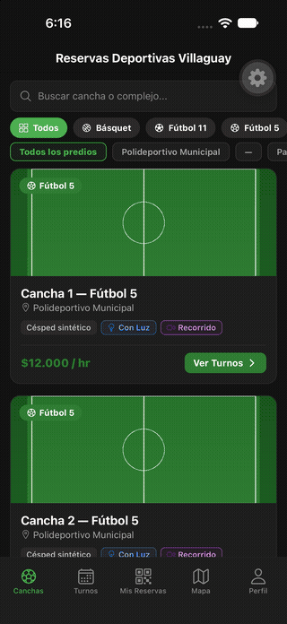
</p>

<p align="center">
  🎬 <strong><a href="docs/media/demo-app.mp4">Ver la demo completa en video (3:40 min)</a></strong> — catálogo, reserva con QR,
  <br>modo offline, escáner del encargado y panel de administración.
</p>

---

## 📌 Sobre el Proyecto

Aplicación móvil desarrollada para la **Dirección de Deportes de la Municipalidad de Villaguay, Entre Ríos**. La solución reemplaza el antiguo sistema de gestión manual por libreta de papel y mensajes de WhatsApp por una plataforma móvil ágil, transparente y robusta.

Permite consultar en tiempo real la disponibilidad de **11 espacios deportivos municipales** (fútbol 5, fútbol 11, básquet, vóley, tenis y gimnasio cerrado), reservar turnos, consultar el código QR de acceso **sin conexión a internet** y gestionar roles diferenciados para jugadores, encargados de predio y administradores.

---

## 📸 Capturas de Pantalla

### Módulo del Jugador

<table>
  <tr>
    <td align="center">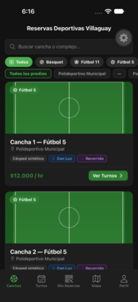<br><sub><b>Catálogo</b> — filtros por deporte y complejo</sub></td>
    <td align="center">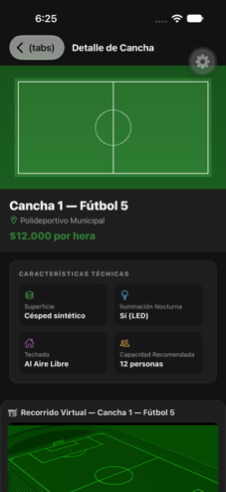<br><sub><b>Ficha</b> — características, video y reglas</sub></td>
    <td align="center">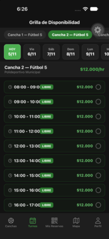<br><sub><b>Disponibilidad</b> — grilla de 7 días</sub></td>
    <td align="center">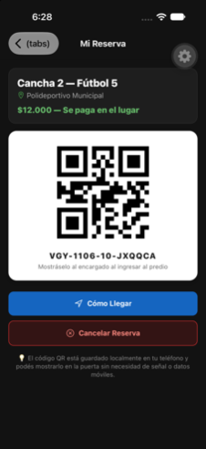<br><sub><b>Reserva</b> — código QR offline</sub></td>
  </tr>
  <tr>
    <td align="center">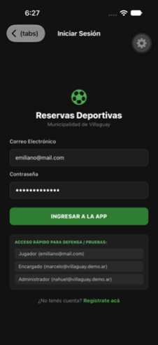<br><sub><b>Acceso</b> — registro e ingreso</sub></td>
    <td align="center">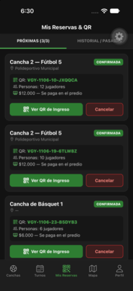<br><sub><b>Mis Reservas</b> — límite 3 activas</sub></td>
    <td align="center">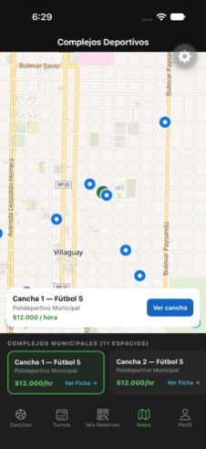<br><sub><b>Mapa</b> — MapLibre + distancias</sub></td>
    <td align="center">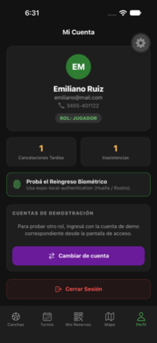<br><sub><b>Perfil</b> — rol y biometría</sub></td>
  </tr>
</table>

### Encargado y Administrador

<table>
  <tr>
    <td align="center">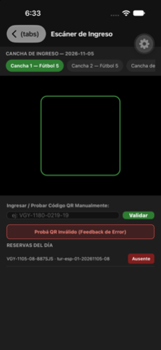<br><sub><b>Escáner</b> — cámara + ingreso manual</sub></td>
    <td align="center">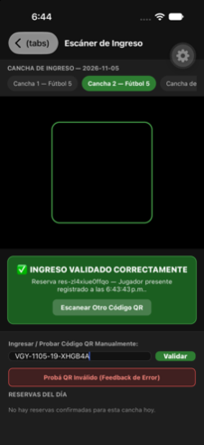<br><sub><b>Ingreso válido</b> — presente registrado</sub></td>
    <td align="center">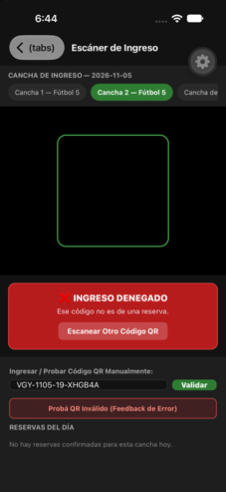<br><sub><b>Ingreso denegado</b> — feedback háptico</sub></td>
    <td align="center">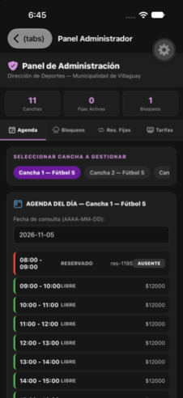<br><sub><b>Panel Admin</b> — agenda, bloqueos y tarifas</sub></td>
  </tr>
</table>

---

## ✨ Características Principales

### 👤 1. Módulo del Jugador

- **Catálogo Interactivo:** Listado de las 11 canchas con filtros por deporte y por complejo deportivo (Polideportivo Municipal, Parque Berduc, Gimnasio Cerrado), características técnicas (superficie, iluminación nocturna, techado), precios y reglas.
- **Multimedia:** Reproductor de recorridos con `expo-video` y un video local de respaldo; `videoUrl` de la API puede ser nulo. Las fotos y notas de voz de observación se procesan en el dispositivo y se suben a la API mediante `POST /archivos`.
- **Grilla de Disponibilidad (7 días):** La API publica los turnos y calcula la disponibilidad combinando reservas, fijas y bloqueos.
- **Reservas & Código QR Offline:** Límite de hasta 3 reservas activas simultáneas. Generación de código QR almacenado localmente en SQLite para ingresar al predio sin señal ni datos móviles.
- **Mapa & Ubicación:** Mapa nativo con `@maplibre/maplibre-react-native` y estilos de OpenFreeMap en Android/iOS; `expo-location` permite ver la distancia a cada predio. Web conserva el listado como alternativa.

### 👮 2. Módulo del Encargado (Marcelo)

- **Reingreso Biométrico:** Opción de verificación con huella dactilar o rostro (`expo-local-authentication`).
- **Escáner QR en Puerta:** Lectura en tiempo real con la cámara del dispositivo (`expo-camera`) para validar el ingreso de los jugadores.
- **Feedback Háptico:** Vibración diferenciada (`expo-haptics`) para accesos aprobados (éxito) vs. accesos inválidos, vencidos o de otra cancha (error).
- **Control de Asistencia:** Opción para marcar usuarios presentes o registrar inasistencias (_ausentes_).

### ⚙️ 3. Módulo del Administrador (Director Nahuel Ojeda)

- **Bloqueos por Mantenimiento / Lluvia:** Gestión de franjas horarias o días enteros con un motivo por escrito.
- **Reservas Fijas Semanales:** Carga y gestión de horarios reservados para clubes, escuelas municipales y grupos históricos.
- **Gestión de Tarifas:** Modificación de precios por hora por espacio deportivo.

---

## 🏆 Capacidades técnicas implementadas

|   #    | Área                           |        Estado         | Implementación Técnica                                                                                                                                                                                                                                                              |
| :----: | ------------------------------ | :-------------------: | ----------------------------------------------------------------------------------------------------------------------------------------------------------------------------------------------------------------------------------------------------------------------------------- |
| **1**  | **Pantallas y Navegación**     |          ✅           | **Expo Router** con navegación basada en archivos (`src/app/`), pestañas inferiores (Tabs), Stack router y layouts limpios.                                                                                                                                                         |
| **2**  | **Autenticación & Seguridad**  |          ✅           | Guardado de Token de sesión en **`expo-secure-store`** y reingreso biométrico con **`expo-local-authentication`**.                                                                                                                                                                  |
| **3**  | **Capa de Servicios y API**    |          ✅           | Cliente HTTP centralizado en `src/servicios/api.ts`, implementado con **Axios**, autenticación Bearer y manejo de respuestas, errores y timeout.                                                                                                                                    |
| **4**  | **Cámara y Archivos**          |          ✅           | Escaneo con **`expo-camera`**; fotos seleccionadas con **`expo-image-picker`**, copiadas al directorio de documentos mediante **`expo-file-system`** (`File`, `Directory`, `Paths`) y subidas a la API.                                                                             |
| **5**  | **Ubicación y Mapas**          |          ✅           | Integración de **`expo-location`** + **MapLibre React Native**. La app sigue funcionando si el usuario deniega la ubicación.                                                                                                                                                        |
| **6**  | **Notificaciones**             | Local ✅ / Remotas ⚙️ | **Local:** recordatorio programado dos horas antes de una reserva, sujeto a permisos y a que ese horario todavía sea futuro. **Remotas:** la API contempla avisos por suspensiones y turnos liberados; la entrega requiere configurar FCM/APNs en EAS y probarla en un dispositivo. |
| **7**  | **Persistencia & Red**         |          ✅           | Base de datos **`expo-sqlite`** para reservas y QR offline, **`expo-sqlite/kv-store`** para preferencias y **`expo-network`** con banner reactivo de sin conexión.                                                                                                                  |
| **8**  | **Sensores / Háptica**         |          ✅           | **`expo-haptics`** con respuestas táctiles diferenciadas al escanear QR válidos (_Success_) e inválidos (_Error_).                                                                                                                                                                  |
| **9**  | **Multimedia**                 |          ✅           | **`expo-video`** para recorridos de canchas y **`expo-audio`** para grabar y reproducir observaciones de audio, subidas a la API junto con los reportes.                                                                                                                            |
| **10** | **Identidad de la Aplicación** |          ✅           | Ícono cuadrado de 1024×1024 PNG sin transparencias en `assets/icon.png`, pantalla de presentación (Splash) e identidad configurada en `app.json`.                                                                                                                                   |

---

## 🛠️ Tecnologías y Librerías

- **Framework:** [React Native](https://reactnative.dev/) + [Expo SDK 57](https://expo.dev/)
- **Lenguaje:** [TypeScript](https://www.typescriptlang.org/)
- **Cliente HTTP:** [Axios](https://axios-http.com/)
- **Navegación:** [Expo Router v57](https://docs.expo.dev/router/introduction/)
- **Mapas nativos:** [MapLibre React Native](https://maplibre.org/maplibre-react-native/) con estilos de [OpenFreeMap](https://openfreemap.org/)
- **Estilos:** `StyleSheet` de React Native (Modo Oscuro de alto contraste para uso nocturno y a la intemperie)
- **Persistencia Nativa:** `expo-sqlite`, `expo-sqlite/kv-store`, `expo-secure-store`
- **Capacidades del Dispositivo:** `expo-camera`, `expo-image-picker`, `expo-file-system`, `expo-location`, `expo-notifications`, `expo-haptics`, `expo-local-authentication`, `expo-video`, `expo-audio`, `expo-network`

---

## 📁 Estructura del Proyecto

```text
Reservas-Deportivas-TPI/
├── src/
│   ├── app/                    # Rutas de Expo Router
│   │   ├── (auth)/             # Login y registro
│   │   ├── (tabs)/             # Pestañas principales
│   │   ├── encargado/          # Flujos del encargado
│   │   ├── admin/              # Flujos de administración
│   │   ├── espacio/[id].tsx    # Detalle de espacio y reportes multimedia
│   │   └── reserva/[id].tsx    # Detalle de reserva y QR
│   ├── tipos/                  # Modelos e interfaces TypeScript
│   ├── mocks/                  # Datos auxiliares de desarrollo
│   ├── servicios/              # Cliente Axios y servicios de dominio
│   ├── bd/                     # SQLite, KV-Store y SecureStore
│   ├── context/                # AuthContext y NetworkContext
│   ├── hooks/                  # Hooks reutilizables
│   └── componentes/            # Componentes de interfaz reutilizables
├── assets/                     # Ícono PNG 1024x1024 sin transparencia, Splash Screen
├── app.json                    # Identidad de la app y permisos nativos de Android/iOS
├── eas.json                    # Configuración de EAS Build (perfil preview para APK)
├── README.md                   # Descripción y ejecución local
└── docs/
    └── DEPLOYMENT.md           # Despliegue, build y entrega
```

---

## 🚀 Instalación y Ejecución Local

### 1. Clonar el repositorio e instalar dependencias

```bash
git clone https://github.com/ferm11n/Reservas-Deportivas-TPI.git
cd Reservas-Deportivas-TPI
npm ci
```

### 2. Iniciar la API (Docker)

La API es un servicio independiente. Con Docker Desktop abierto, iniciá una segunda terminal en la carpeta de la API:

```powershell
cd ..\api-reservas-deportivas
docker compose up
```

La API queda disponible en `http://localhost:3000`. Verificá `http://localhost:3000/salud` y la documentación interactiva en `http://localhost:3000/docs`.

### 3. Configurar y ejecutar la app

Configurá la URL base en `.env` (copiá `.env.example` si todavía no existe):

```env
EXPO_PUBLIC_API_URL=http://<DIRECCION-ACCESIBLE-DE-LA-API>:3000
```

En un teléfono físico, usá una dirección que el teléfono pueda alcanzar (por ejemplo, la IP local de la computadora si ambos están en la misma red). `localhost` desde el teléfono apunta al propio teléfono, no a la computadora. La app incluye `.env.example` y `.env` no se versiona.

Para probar cuentas demo, la API documenta las cuentas y la contraseña `villaguay2026` en su README. No uses esas credenciales en un entorno con datos reales.

Iniciá Metro:

```bash
npx expo start -c
```

### 4. Probar en el dispositivo

- **Android/iOS:** MapLibre incluye código nativo y no está incluido en Expo Go. Generá e instalá un development build con `npx eas-cli build --profile development --platform android` (o `ios`) y luego iniciá Metro con `npx expo start --dev-client`. También podés compilar localmente con `npx expo run:android` o `npx expo run:ios`.
- **En la Web:** Presionar `w` en la consola o ejecutar `npx expo start --web`.

---

## 📦 Compilación del Build Instalable (APK)

El perfil `preview` genera un APK instalable. Antes de compilar para entregar, configurá `EXPO_PUBLIC_API_URL` con la URL HTTPS pública de la API. Actualmente, `eas.json` contiene una dirección de desarrollo local; ese valor no sirve para usuarios que estén fuera de tu red.

```bash
# Iniciar sesión en Expo (si es necesario)
npx eas-cli login

# Generar el APK
npx eas-cli build --platform android --profile preview
```

Al finalizar la compilación en EAS, descargá e instalá el APK y probá los flujos principales desde una red distinta a la de desarrollo. Un build `development` sirve para desarrollar con Metro; no es el APK autónomo de entrega.

## 🔔 Notificaciones

- **Recordatorio local:** la app programa un aviso dos horas antes de la reserva si el horario todavía no pasó y el usuario concede permiso. No necesita Firebase ni conexión en el momento del aviso.
- **Avisos remotos:** la API puede enviar notificaciones por suspensión de reservas y liberación de turnos favoritos. Para su entrega en dispositivos se requieren las credenciales de push de la plataforma configuradas en EAS (FCM v1 para Android y APNs para iOS), además de una API publicada y accesible.
- La configuración de envío de la API está documentada en `docs/NOTIFICATIONS.md` dentro del proyecto de la API. Expo Go en Android no sirve para validar push remotas; usá un development build o un APK de release.

## 📤 Preparar la entrega

- Entregá el APK `preview` final si la consigna pide un instalable Android.
- Compartí el código fuente mediante los repositorios correspondientes o un ZIP que incluya la app y la API. La API es un proyecto separado; no la mezcles dentro de la carpeta de la app.
- Incluí `app.json`, `eas.json` y los archivos de documentación.
- Excluí `node_modules`, `.env`, claves de servicio y cualquier otro secreto. No publiques credenciales de Supabase, Firebase/FCM, APNs ni tokens.
- Si se entrega un dashboard de Power BI, compartí una vista con datos ficticios o agregados y no publiques credenciales de base de datos.

La API y el dashboard deben estar efectivamente desplegados y probados antes de presentarlos como servicios disponibles. Los pasos de configuración están en [`docs/DEPLOYMENT.md`](docs/DEPLOYMENT.md).

---

## 🎓 Créditos

Desarrollado para la materia **Desarrollo para Móviles** (2do Cuatrimestre 2026).  
**Tecnicatura Universitaria en Desarrollo Web — UNER**.
